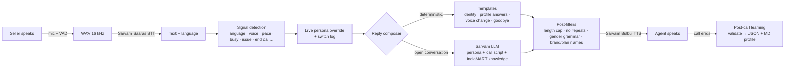
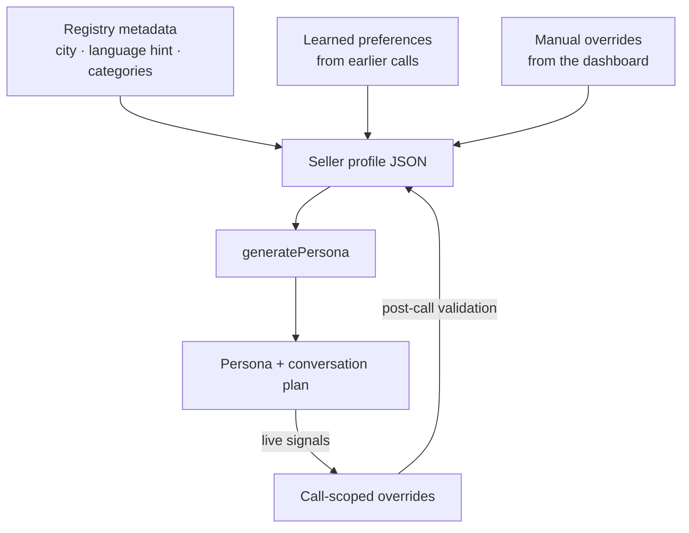

<div align="center">

# 🎙️ Adaptive Persona Voice Agent

### An IndiaMART seller-success voice agent that adapts its personality to every seller — and remembers.

**IndiaMART Voice AI Hackathon 2.0** · Built with **Next.js 15 · React 19 · TypeScript · Tailwind CSS 4 · Sarvam AI**

</div>

---

## 📌 Table of contents

1. [The problem](#-the-problem)
2. [What it does](#-what-it-does)
3. [Feature highlights](#-feature-highlights)
4. [Quick start](#-quick-start)
5. [Configuration](#%EF%B8%8F-configuration)
6. [Demo walkthrough](#-demo-walkthrough-3-minutes)
7. [How it works](#-how-it-works)
8. [The persona engine](#-the-persona-engine)
9. [Call script & conversation rules](#-call-script--conversation-rules)
10. [Voices & languages](#%EF%B8%8F-voices--languages)
11. [Seller data & profiles](#-seller-data--profiles)
12. [API reference](#-api-reference)
13. [Project structure](#-project-structure)
14. [Deployment](#-deployment)
15. [Privacy & safety](#-privacy--safety)
16. [Limitations & roadmap](#-limitations--roadmap)

---

## 🎯 The problem

IndiaMART has lakhs of paying sellers, and every one of them is different: a TMT-bar trader in Delhi wants short Hindi answers, a textile mill owner in Coimbatore prefers slow Tamil, a busy agro-implements maker in Ludhiana wants a male voice and only the numbers. A one-size-fits-all calling script (or a one-size-fits-all bot) frustrates them all.

**This project is a voice agent whose persona is built per seller, adapts live during the call, and is written back to that seller's profile afterwards** — so every call is better than the last one.

## ✨ What it does

| | |
|---|---|
| 🔎 **Find a seller** | Search by **GLID** (IndiaMART's seller ID) from a modern dashboard. |
| 🧠 **Inspect the persona** | See *how* the agent will talk to this seller — language, voice, tone, pace, answer length… each with its reason, evidence and confidence. |
| 📞 **Call the seller** | One click. The agent confirms identity, asks for feedback, solves app issues, books a meeting and pitches paid plans. |
| 🔁 **Adapt live** | "Tamil mein baat karo", "aadmi ki aawaaz mein boliye", "short mein bataiye", "I'm busy" — the agent switches on the very next reply. |
| 💾 **Learn & remember** | After the call, observations are validated and saved to the seller's **JSON + Markdown** profile. The next call starts with what was learned. |

## 🚀 Feature highlights

**Adaptive persona**
- 10 persona dimensions: language, language style, voice gender, tone, formality, pace, response length, explanation detail, opening style, objection handling.
- Every value carries **source** (default / metadata / learned / manual / this-call), **confidence**, **observation count** and **evidence quotes**.
- **Evidence-based learning** — one contrary request never overwrites a preference backed by several observations; manual overrides are protected.

**Live adaptation during the call**
- **11 Indian languages** — Hindi, English, Bengali, Tamil, Telugu, Kannada, Malayalam, Marathi, Gujarati, Punjabi, Odia. Ask for one, or simply start speaking it — the agent mirrors the seller.
- **Voice switching** — male ⇄ female ("I want to talk to a male", "aadmi ki aawaaz mein baat kijiye"), or a *different* voice of the same gender ("aapki awaaz achhi nahi") — e.g. **Neha → Priya**. The new voice introduces itself by name.
- **Style switching** — shorter, more detailed, slower, faster, "no time — jaldi bataiye".
- **Correct grammar for the voice** — a male agent says *"करता हूँ / समझ गया"*, a female agent *"करती हूँ / समझ गई"* (Hindi, Hinglish, Punjabi, Marathi).
- **"Call cut kar dijiye"** ends the call immediately with a one-line thank-you.

**Human-sounding conversation**
- Short, concise spoken replies (hard length cap), no repeated sentences, and a question is never asked twice — if the seller ignores it, the agent moves on.
- Acknowledgements like *"अच्छा / हाँ जी"* are rationed (max one per reply, never twice in a row).
- Barge-in: the seller can interrupt the agent mid-sentence.
- Never calls itself an "AI bot" — it is IndiaMART's **seller help assistant** (and never claims to be human).

**IndiaMART domain knowledge**
- Built-in knowledge of the **seller app**: Home, **BuyLeads** (Relevant / Recent / Catalog / Expired / Shortlisted / Hidden / Search tabs, filters, *Contact Buyer Now* consuming BuyLead balance), **Lead Manager**, **Add Products**, PNS.
- Answers "what is my GLID / registered mobile number?" exactly from the seller's record (digits read one by one).
- Plan names stay correct in every language (*IM Leader*, never *IM नेता*).
- Escalates to the senior team **only** when the seller is frustrated or wants an urgent fix — not on every complaint.

**Dashboard**
- Overview, GLID search, seller explorer with filters, seller detail (Overview · Persona · BuyLeads · Profile), live call screen, call history, settings.
- **Live persona panel** — pointers flash "Updated" and show the previous value the moment the seller changes something.
- Post-call summary: every profile field that changed, why, and what was rejected by the validator.

## ⚡ Quick start

**Prerequisites:** Node.js 20+ · Chrome or Edge (for the microphone) · a Sarvam AI API key (optional but recommended).

```bash
git clone https://github.com/robust-vish/Voice-hackathon-2.0-.git
cd Voice-hackathon-2.0-
npm install
cp .env.example .env.local       # then paste your SARVAM_API_KEY
npm run build && npm start       # → http://localhost:3000
```

> 💡 Use `npm run dev` while developing. For demos always use `build` + `start` — it is much faster (no on-demand compilation).

**Voice tips:** allow the microphone, and use headphones so the agent doesn't hear itself (or untick *"Allow interrupting the agent"* on the call screen).

### Getting a Sarvam API key
1. Sign in at **[dashboard.sarvam.ai](https://dashboard.sarvam.ai)** (hackathon teams: join your organisation with the Org ID shared by your team lead).
2. Open **API Keys** → create a key.
3. Put it in `.env.local` as `SARVAM_API_KEY=...` — never commit this file (it is git-ignored).

**Without a key** the app still runs: speech uses the browser's built-in engines and replies come from deterministic templates (Hindi/English).

## ⚙️ Configuration

All settings live in `.env.local` (see `.env.example`).

| Variable | Default | Purpose |
|---|---|---|
| `SARVAM_API_KEY` | — | Enables Sarvam STT, TTS, translation and the LLM. |
| `SARVAM_TTS_MODEL` | `bulbul:v3` | Text-to-speech model. |
| `SARVAM_STT_MODEL` | `saaras:v3` | Speech-to-text model (code-mixed mode). |
| `SARVAM_LLM_MODEL` | `sarvam-105b` | Chat model that writes the replies. |
| `SARVAM_LLM_REASONING` | `off` | `off` is fastest; `low/medium/high` adds hidden reasoning (slower). |
| `SARVAM_TTS_TEMPERATURE` | `0.75` | Expressiveness of the voice (0–1). |
| `SARVAM_FEMALE_SPEAKER` / `SARVAM_MALE_SPEAKER` | `neha` / `rahul` | Default voices (any Bulbul v3 speaker). |
| `DATA_DIR` | `./data` | Where profiles and interactions are stored. |
| `DISABLE_LLM` | — | `1` = template replies only (no LLM calls). |
| `DEBUG_LLM` | — | `1` = log raw LLM output on the server. |
| `TELEPHONY_PROVIDER` | `none` | Placeholder for a future PSTN adapter (see roadmap). |

## 🎬 Demo walkthrough (3 minutes)

1. **Overview** — search GLID **`6601433`** (Komal, Bangalore) or use a *Quick open* chip.
2. **Persona tab** — see Hindi, female voice "Neha", warm tone, balanced answers, each with its reason.
3. **Call seller → Start call.** Pre-call checks (GLID, profile, PNS mapping, persona, interaction ID, provider) run silently; the agent opens with *"नमस्ते! क्या मेरी बात Komal जी से हो रही है?"*
4. Speak as the seller and watch the **Persona** side-panel update live:

   | Say | What happens |
   |---|---|
   | "Haan ji, main Komal bol rahi hoon" | Identity confirmed → feedback question with tenure & BuyLead categories |
   | "BuyLeads bahut kam mil rahe hain" | App guidance from the knowledge base (filters, preferences) |
   | "Aapki awaaz achhi nahi lag rahi" | Voice **Neha → Priya**, intro by name |
   | "Aadmi ki aawaaz mein baat kijiye" | Voice **female → male (Rahul)**, verbs switch to masculine |
   | "Please speak in English" / just speak Tamil | Language switches on the next reply |
   | "Time nahi hai, jaldi bataiye" | Pace → fast, answers → concise |
   | "Mera GLID aur mobile number kya hai?" | Read out exactly from the record |
   | "Kal shaam 5 baje free hoon meeting ke liye" | Meeting booked → paid-plan pitch |
   | "Call cut kar dijiye" | Short thank-you, call ends |

5. **Post-call processing** shows each profile field that changed and why; `data/sellers/6601433.json` and `.md` are regenerated.
6. **Call again** — the new call starts with the learned language, voice and style.

> Try the demo sellers too: **`90000004`** (Punjabi, wants a male voice and short answers) or **`90000006`** (Marathi, data-driven, call after 6 PM).

## 🧩 How it works



**One turn, step by step**
1. **Listen** — an always-open mic with voice-activity detection cuts the utterance after ~0.6 s of silence (400 ms pre-roll so the first syllable isn't lost). The seller can barge in while the agent speaks.
2. **Transcribe** — Sarvam *Saaras v3* in code-mixed mode, so "male voice में बोलिए" keeps English words in Latin script.
3. **Detect signals** — deterministic, explainable rules across English, Hinglish, Devanagari and native scripts (native-script speech is also translated to English and re-checked).
4. **Adapt** — each signal maps to a call-scoped persona override and a switch-log entry: *previous → new, why, temporary or persistent*.
5. **Reply** — fixed lines where exactness matters (identity, profile details, voice change, goodbye); otherwise the Sarvam LLM with the persona, call script, IndiaMART knowledge and strict JSON output.
6. **Polish** — length cap, repeated-sentence removal, filler rationing, gender-correct verbs, "help assistant" wording, correct brand & plan names, language enforcement.
7. **Speak** — Sarvam *Bulbul v3*, sentence-chunked and played gaplessly; a short "जी…" may play while the agent thinks.
8. **Learn** — on hang-up, observations are validated and merged into the profile.

## 🧠 The persona engine

**Where a persona comes from**



**Learning rules** (`learnPreference` in `src/lib/profile.ts`)

| Situation | Rule |
|---|---|
| Explicit request ("Tamil mein baat karo") | Replaces a default or metadata value immediately. |
| Inferred signal (seller *sounds* casual) | Needs **2 observations** before it is saved. |
| Existing learned value | Only replaced by evidence at least as strong (observations × explicitness). |
| Manual override | Kept unless the seller says **"always / hamesha"**. |
| Every update | Records source, confidence, observation count, evidence quotes and a change-log entry. |

**Profile status:** `New` → `Provisional` (some evidence) → `Established` (enough consistent evidence).

## 🗣️ Call script & conversation rules

| Stage | What the agent does |
|---|---|
| 1. Identity | "Am I speaking with *Komal ji*?" (adds company when known; asks the name when unknown) |
| 2. Feedback | Introduces itself, mentions tenure / BuyLead categories, asks about issues |
| 3. Resolve | Solves the issue with app guidance; escalates **only** if the seller is frustrated or wants it fixed urgently |
| 4. Meeting | Asks for a slot for a short meeting with the IndiaMART team |
| 5. Pitch | Paid-plan benefits — more BuyLeads, visibility, TrustSEAL (no invented numbers) |
| 6. Catalog | Asks for a missing product price, if any |
| 7. Open | Answers IndiaMART questions until **the seller** ends the call |

**Always on:** replies of 1–2 short sentences · one question at a time · never repeat a question · politely refuse non-IndiaMART topics · busy seller → offer a callback time · mirror the seller's language · never ask for OTPs, passwords or bank details.

## 🎙️ Voices & languages

| | Voices (Sarvam Bulbul v3) — rotation order |
|---|---|
| 👩 Female | **Neha** (default) → Priya → Simran → Kavya → Ritu → Shreya → Pooja |
| 👨 Male | **Rahul** (default) → Aditya → Rohan → Amit → Kabir → Varun → Shubh |

A voice the seller rejected is never offered again in that call, and the voice they settle on is saved as their **preferred voice** for the next call.

**Languages:** Hindi · English · Bengali · Tamil · Telugu · Kannada · Malayalam · Marathi · Gujarati · Punjabi · Odia.

## 🗂️ Seller data & profiles

| Path | Contents |
|---|---|
| `data/registry.json` | Seller registry (stands in for IndiaMART's authorised seller registry) |
| `data/sellers/<GLID>.json` | The living profile: preferences + evidence, memory, history, change log |
| `data/sellers/<GLID>.md` | Human-readable Markdown version, regenerated on every save |
| `data/interactions/<id>.json` | Full call record: turns, signals, switch log, post-call summary |
| `data/metrics.json` | Dashboard counters |

**Sellers in the registry**

| GLID | Seller | City | Type |
|---|---|---|---|
| 6601433 | Komal | Bangalore | Real (provided by IndiaMART) |
| 7349419 | Shobhna | Delhi | Real |
| 37627888 | Manish Murli | NCR | Real |
| 218447291 | Soumya Sarkar | Kolkata | Real |
| 90000001–90000006 | Ramesh Agarwal, Kiran Reddy, Lakshmi Narayanan, Gurpreet Singh, Anjali Sharma, Prakash Patil | various | Demo (synthetic, with prior-call learnings) |

**IndiaMART identifiers:** a seller is identified by a numeric **GLID**; a BuyLead by a numeric **offer ID** (a BuyLead expires once consumed); catalog products by a numeric **product ID**.

New sellers added to `src/lib/seed-data.ts` are merged into existing data on the next start — existing profiles and call history are never wiped.

## 🔌 API reference

| Method | Endpoint | Description |
|---|---|---|
| `GET` | `/api/sellers?q=&language=&status=&category=&page=&pageSize=` | Search / list sellers |
| `GET` | `/api/sellers/:glid` | Profile, persona, plan and any active call |
| `GET` | `/api/sellers/:glid/markdown` | The Markdown profile |
| `PATCH` | `/api/sellers/:glid/persona` | Manual override `{ field, value, note }` |
| `POST` | `/api/calls` | Prepare a call `{ glid, mode: "web" }` → interaction + pre-call checks |
| `POST` | `/api/calls/:id/start` | Connect and get the opening line |
| `POST` | `/api/calls/:id/turn` | Seller utterance `{ text, languageCode?, probability? }` → agent reply |
| `POST` | `/api/calls/:id/end` | End the call and run post-call learning |
| `POST` | `/api/calls/:id/postprocess` | Retry post-call processing |
| `POST` | `/api/calls/:id/simulate` | Next line of the scripted test seller (API-only test mode) |
| `GET` | `/api/calls/:id` · `/api/interactions?glid=` | Call details / history |
| `POST` | `/api/stt` · `/api/tts` | Speech-to-text (multipart `file`) / text-to-speech `{ text, language, gender, speaker, pace }` |
| `GET` | `/api/stats` · `/api/config?probe=1` | Dashboard numbers / provider status |
| `POST` | `/api/admin/reset` | Restore the seed dataset (**wipes profiles and calls**) |

## 🏗️ Project structure

```
src/
├─ app/                       Next.js App Router
│  ├─ page.tsx                Overview (hero search, stats, sellers, recent calls)
│  ├─ sellers/ · search/      Seller explorer, GLID search, seller detail & persona
│  ├─ call/[glid]/            Live call screen (transcript, live persona, adaptations, plan)
│  ├─ interactions/ · config/ Call history, settings
│  └─ api/                    REST routes (sellers, calls, stt, tts, stats, config)
├─ components/
│  ├─ voice.ts                Mic + VAD, WAV encoding, gapless TTS playback, fillers
│  ├─ PersonaGrid.tsx         Live persona "pointers"
│  ├─ SellerDetail.tsx        Overview · Persona · BuyLeads · Profile tabs
│  └─ Shell.tsx · ui.tsx      Layout, sidebar, design-system components
└─ lib/
   ├─ types.ts                Domain model
   ├─ seed-data.ts            Seller registry seed (real + demo sellers)
   ├─ store.ts                File storage (JSON + Markdown)
   ├─ profile.ts              Profile creation, learnPreference validator, Markdown
   ├─ persona.ts              Persona & conversation plan, voice selection
   ├─ signals.ts              Signal detection (11 languages, Hinglish, negation-aware)
   ├─ adaptation.ts           Signal → persona override + switch log
   ├─ agent.ts                Reply composer: templates + LLM + post-filters
   ├─ grammar.ts              Gender-correct verbs, filler rationing, brand/plan names
   ├─ knowledge.ts            IndiaMART seller-app knowledge base
   ├─ calls.ts                Call lifecycle & post-call learning
   ├─ languages.ts            Languages, voice roster, script detection
   ├─ sarvam.ts               Sarvam REST client (STT, TTS, translate, chat)
   └─ telephony.ts            Provider adapters (web / simulated / PSTN placeholder)
```

## ☁️ Deployment

**Any Node host (recommended: Render / Railway / a VM)**
```bash
npm install && npm run build && npm start
```
Set `SARVAM_API_KEY` in the host's environment settings.

**Vercel**
1. Import the GitHub repo; framework = Next.js.
2. Environment variables: `SARVAM_API_KEY=…` and **`DATA_DIR=/tmp/voice-agent-data`** (Vercel's filesystem is read-only except `/tmp`).
3. Deploy. The HTTPS URL works with the browser microphone.

> ⚠️ On serverless hosts, `/tmp` is per-instance and temporary: learned profiles reset when an instance is recycled, and on rare occasions a call may lose its state between instances. For a permanent deployment, swap `src/lib/store.ts` for a database/KV adapter (the rest of the app only talks to the store's functions).

## 🔒 Privacy & safety

- API keys stay on the server (`.env.local`, git-ignored); the browser never sees them.
- Mobile numbers are **masked** in profiles, API responses and the UI (`95XXXXX261`). The full number is read out **only to the seller themself** when they ask, and is never sent to the LLM (digit runs are masked in the LLM history).
- The agent never asks for OTPs, passwords or bank details, refuses unrelated topics, and never claims to be a human.
- Every learned change is auditable: source, evidence quote, confidence and change log.

## 🛣️ Limitations & roadmap

| Today | Next |
|---|---|
| Calls run in the browser (web voice), clearly labelled — not a PSTN phone call | Exotel / Twilio adapter in `telephony.ts` with a PNS-mapped caller ID |
| File-based storage | Database / KV store for multi-instance hosting |
| Replies are generated per turn (no streaming) | Streaming LLM → streaming TTS for sub-second first audio |
| Registry is a local file | Authorised IndiaMART seller-registry integration |

---

<div align="center">

Built for the **IndiaMART Voice AI Hackathon 2.0** · Powered by **[Sarvam AI](https://www.sarvam.ai)** (Saaras STT · Bulbul TTS · Mayura translate · Sarvam-105B)

</div>
